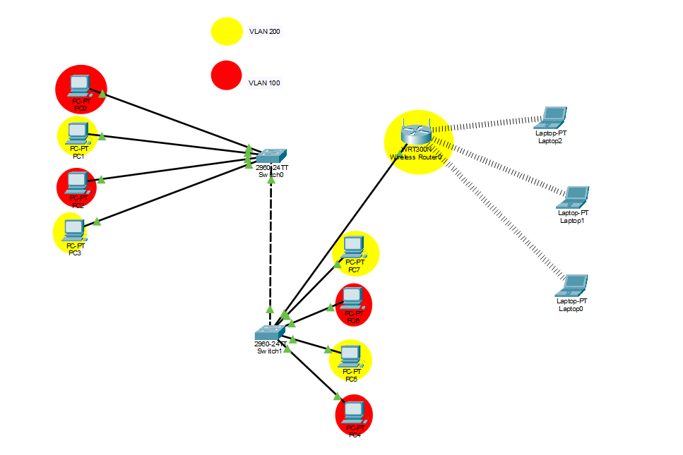

# Projeto de Segmentação de Rede com VLANs

> Projeto de laboratório desenvolvido no Cisco Packet Tracer para praticar segmentação lógica de uma rede local com VLANs, switches gerenciáveis e um roteador wireless.

## Visão geral

O objetivo é separar os dispositivos da rede em duas VLANs, distribuídas entre dois switches, mantendo a conectividade física da topologia e permitindo estudar a segmentação lógica da rede.

- **VLAN 100:** PC0, PC2, PC4 e PC6.
- **VLAN 200:** PC1, PC3, PC5, PC7 e o roteador wireless.
- **Equipamentos principais:** 2 switches Cisco 2960-24TT e 1 roteador wireless WRT300N.
- **Ambiente:** Cisco Packet Tracer.

## Topologia



*A imagem mostra os dispositivos finais, os dois switches, o enlace entre switches e o roteador wireless com clientes conectados por Wi-Fi.*

## Inventário de dispositivos

| Equipamento | Conexões/dispositivos | Porta indicada |
|---|---|---|
| SW1 — Switch0 | PC0 | Faixa documentada: portas 11–14 |
| SW1 — Switch0 | PC1 | Faixa documentada: portas 11–14 |
| SW1 — Switch0 | PC2 | Faixa documentada: portas 11–14 |
| SW1 — Switch0 | PC3 | Faixa documentada: portas 11–14 |
| SW2 — Switch1 | PC4 | Faixa documentada: portas 11–14 |
| SW2 — Switch1 | PC5 | Faixa documentada: portas 11–14 |
| SW2 — Switch1 | PC6 | Faixa documentada: portas 11–14 |
| SW2 — Switch1 | PC7 | Faixa documentada: portas 11–14 |
| SW2 — Switch1 | Roteador wireless | Porta 02 |
| SW1 ↔ SW2 | Enlace entre switches | Configurar como trunk, se transportar ambas as VLANs |

**Observação sobre as portas:** o inventário fornecido informa que as portas 1–10 estão ocupadas, mas identifica os PCs nas portas 11–14. Confirme no Packet Tracer a numeração exata de cada interface e a porta usada pelo enlace entre os switches antes de aplicar comandos.

## Segmentação lógica

| VLAN | Dispositivos associados | Finalidade |
|---|---|---|
| VLAN 100 | PC0, PC2, PC4, PC6 | Grupo lógico 100 |
| VLAN 200 | PC1, PC3, PC5, PC7, roteador wireless | Grupo lógico 200 |

A VLAN cria domínios de broadcast separados na camada 2. Para que dispositivos de VLANs diferentes se comuniquem, é necessário configurar roteamento entre VLANs em um dispositivo de camada 3, além das regras de segurança apropriadas.

## Plano de endereçamento IP

### PCs conectados aos switches

| Dispositivo | VLAN | Switch | Porta informada | Endereço IP | Máscara |
|---|---:|---|---:|---|---|
| PC0 | 100 | SW1 | 11 | `192.168.10.10` | `255.255.255.0` (/24) |
| PC1 | 200 | SW1 | 12 | `192.168.10.20` | `255.255.255.0` (/24) |
| PC2 | 100 | SW1 | 13 | `192.168.10.30` | `255.255.255.0` (/24) |
| PC3 | 200 | SW1 | 14 | `192.168.10.40` | `255.255.255.0` (/24) |
| PC4 | 100 | SW2 | 11 | `192.168.10.50` | `255.255.255.0` (/24) |
| PC5 | 200 | SW2 | 12 | `192.168.10.60` | `255.255.255.0` (/24) |
| PC6 | 100 | SW2 | 13 | `192.168.10.70` | `255.255.255.0` (/24) |
| PC7 | 200 | SW2 | 14 | `192.168.10.80` | `255.255.255.0` (/24) |

- **Gateway informado:** `192.168.10.1`
- **Rede/máscara informadas para os PCs:** `192.168.10.0/24`

> **Atenção — endereçamento a validar:** os PCs das VLANs 100 e 200 foram documentados na mesma sub-rede `192.168.10.0/24`. Em uma implementação comum com VLANs roteadas, cada VLAN deve ter uma sub-rede própria e um gateway correspondente. Se o objetivo for manter as VLANs isoladas, revise o plano IP; se precisar de comunicação entre elas, planeje o roteamento de camada 3.

### Roteador wireless

| Parâmetro | Valor |
|---|---|
| Equipamento | WRT300N |
| Conectado ao | SW2 |
| Porta indicada no switch | 02 |
| IP WAN estático | `192.168.10.90/24` |
| IP LAN | `192.168.1.1/24` |
| Gateway da LAN | `192.168.1.1` |
| DHCP | Ativado, conforme configuração informada |
| Faixa DHCP | `192.168.1.100` – `192.168.1.200` |

Os notebooks Laptop0, Laptop1 e Laptop2 aparecem conectados ao roteador wireless pela rede Wi-Fi. Eles devem receber endereços da faixa DHCP da LAN, caso o serviço DHCP esteja habilitado e a associação wireless esteja configurada corretamente.

**Nota sobre o gateway:** `192.168.1.1` é o gateway dos clientes da LAN wireless. O gateway da interface WAN depende da rede upstream e não foi informado; não presuma que seja o mesmo endereço.

## Configuração das VLANs nos switches

Os comandos abaixo são um **modelo Cisco IOS**. Ajuste as interfaces conforme a ligação real do arquivo Packet Tracer. Configure o mesmo número e nome de VLAN nos dois switches.

### 1. Criar as VLANs

Execute em **SW1 e SW2**:

```text
enable
configure terminal

vlan 100
 name VLAN100
exit

vlan 200
 name VLAN200
exit

end
show vlan brief
```

### 2. Configurar as portas de acesso — exemplo

No **SW1**, considerando provisoriamente que PC0–PC3 usam `Fa0/11` a `Fa0/14`:

```text
configure terminal

interface FastEthernet0/11
 switchport mode access
 switchport access vlan 100
exit

interface FastEthernet0/12
 switchport mode access
 switchport access vlan 200
exit

interface FastEthernet0/13
 switchport mode access
 switchport access vlan 100
exit

interface FastEthernet0/14
 switchport mode access
 switchport access vlan 200
exit

end
show vlan brief
```

No **SW2**, considerando provisoriamente que PC4–PC7 usam `Fa0/11` a `Fa0/14`:

```text
configure terminal

interface FastEthernet0/11
 switchport mode access
 switchport access vlan 100
exit

interface FastEthernet0/12
 switchport mode access
 switchport access vlan 200
exit

interface FastEthernet0/13
 switchport mode access
 switchport access vlan 100
exit

interface FastEthernet0/14
 switchport mode access
 switchport access vlan 200
exit

end
show vlan brief
```

> Os comandos de portas são exemplos baseados no mapeamento informado. Confirme se as interfaces são `FastEthernet0/x` e se os cabos estão conectados a essas portas. Não aplique a configuração da porta do roteador wireless sem decidir se ele deve ficar em uma VLAN de acesso ou em uma rede específica para a WAN.

### 3. Configurar o enlace entre switches como trunk

Para que as VLANs 100 e 200 atravessem o enlace entre SW1 e SW2, configure como trunk **a interface realmente conectada ao outro switch, em ambas as pontas**. Exemplo ilustrativo:

```text
configure terminal
interface GigabitEthernet0/1
 switchport mode trunk
 switchport trunk allowed vlan 100,200
end

show interfaces trunk
```

Confirme o nome e o número da interface usada no enlace. Alguns modelos ou portas do Packet Tracer podem apresentar diferenças de nomenclatura.

## Configuração dos hosts

Em cada PC, configure o endereço IP e a máscara da tabela de endereçamento. Configure o gateway somente após definir o roteamento e a sub-rede correspondente à VLAN. Com a configuração atual, `192.168.10.1` é apenas o gateway informado; a topologia apresentada não identifica claramente um roteador de camada 3 responsável por esse endereço.

No WRT300N, configure:
1. WAN como IP estático `192.168.10.90`, máscara `255.255.255.0` e o gateway upstream correto.
2. LAN como `192.168.1.1`, máscara `255.255.255.0`.
3. DHCP da LAN entre `192.168.1.100` e `192.168.1.200`.
4. SSID e segurança Wi-Fi conforme necessário para o laboratório.

## Plano de testes

Após configurar a rede, valide e registre os resultados:

- [ ] `show vlan brief`: VLANs 100 e 200 existem e as portas de acesso pertencem à VLAN correta.
- [ ] `show interfaces trunk`: o enlace entre switches está em trunk e permite as VLANs 100 e 200.
- [ ] `ipconfig` nos PCs: endereço IP e máscara correspondem ao plano.
- [ ] `ping` entre PCs da mesma VLAN, incluindo PCs em switches diferentes.
- [ ] Verificar se PCs de VLANs diferentes ficam isolados quando não há roteamento entre VLANs.
- [ ] Verificar a associação Wi-Fi dos notebooks e o recebimento de IP por DHCP.
- [ ] Testar acesso entre a LAN wireless e as VLANs cabeadas apenas se isso fizer parte do objetivo do projeto.

**Resultado esperado:** dispositivos da mesma VLAN devem conseguir se comunicar através do trunk, desde que endereçamento e portas estejam corretos. VLANs diferentes devem permanecer separadas na camada 2; comunicação entre elas exige roteamento.

## Competências demonstradas

- Conceitos de VLAN e segmentação de rede.
- Configuração de portas access e enlaces trunk.
- Noções de endereçamento IPv4 e DHCP.
- Documentação de topologia e inventário de rede.
- Validação de conectividade e diagnóstico básico.

## Próximas melhorias

- Corrigir/validar o plano de endereçamento para usar uma sub-rede por VLAN.
- Adicionar roteamento entre VLANs apenas se necessário.
- Documentar a configuração real das interfaces e o resultado dos comandos de verificação.
- Incluir evidências dos testes (`ping`, `show vlan brief`, `show interfaces trunk`) e o arquivo `.pkt`.
- Registrar decisões de segurança, como VLAN de gerenciamento e restrição de portas não utilizadas.

---

*Projeto de laboratório educacional. Os endereços e comandos documentados devem ser validados no arquivo do Packet Tracer antes de serem usados em uma rede real.*
